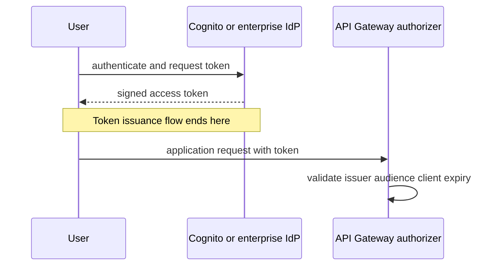
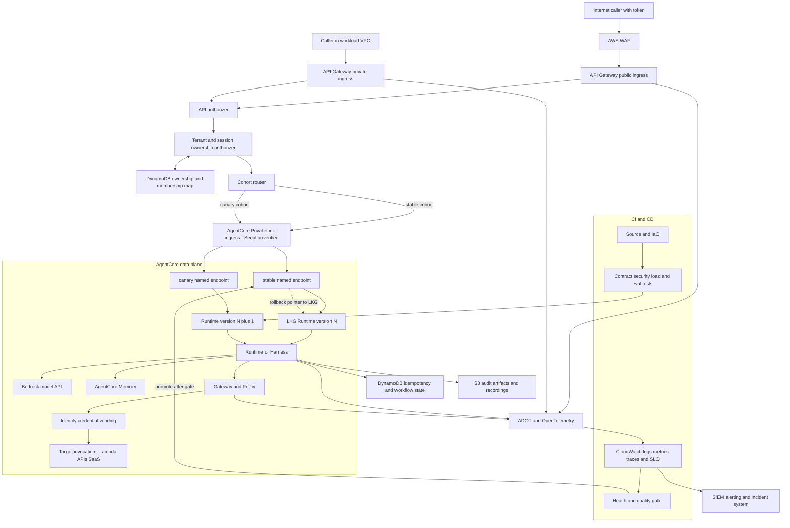
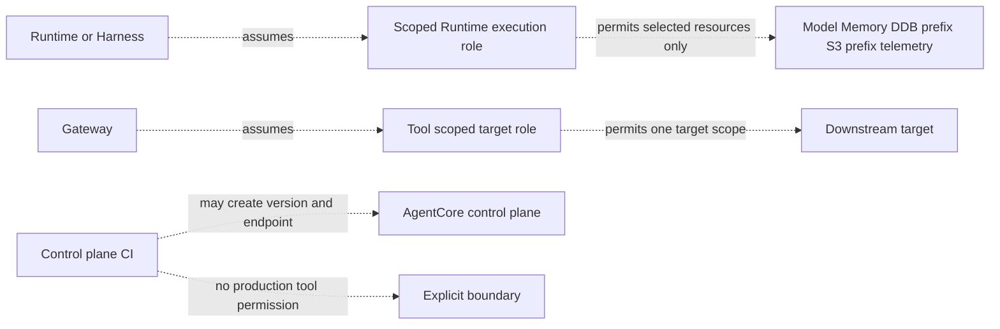

에이전트 한 번의 응답은 하나의 제품처럼 보이지만 청구와 장애는 하나가 아니다. Amazon Bedrock AgentCore는 특정 모델이나 프레임워크에 묶이지 않고 에이전트를 구축하고 연결하고 운영하기 위한 모듈형 서비스다.[1] 이 설명의 중요한 단어는 **모듈형**이다. 모델 추론, agent compute, 도구 호출, credential 교환, 기억, telemetry, 브라우저, 코드 실행, 평가는 서로 다른 데이터 plane이다. 따라서 “AgentCore 요청 1회”라는 단일 비용 단위도 없고, 모든 구성 요소에 공통인 단일 quota나 IAM action도 없다.

**모델 토큰과 AgentCore 실행 시간을 먼저 분리하고, 각 capability를 별도 API·quota·IAM·SLO·meter로 예산화해야 한다.** 한 trace로 연결하는 것은 필요하지만 한 서비스처럼 합산해 원인을 숨겨서는 안 된다. 이 경계를 지키면 느린 응답이 모델 때문인지 cold start 때문인지 구분할 수 있다. Gateway 오류와 downstream 오류도 분리할 수 있고, “메모리를 켰더니 왜 모델 비용이 늘었나”라는 질문에도 retrieved context token이라는 연결 고리를 찾을 수 있다.

## 2026년 10월 17일 기준으로 무엇을 다루는가

이 글은 이번 주의 단일 출시 소식을 요약한 뉴스가 아니다. 2026년 10월 17일 현재의 AgentCore 가운데 일반적인 serverless agent 경로에 직접 연결되는 **선정한 아홉 capability**를 묶어 보는 사용자 지정 딥다이브다. Runtime은 agent 또는 tool 코드를 올리는 compute layer다. Gateway는 API·Lambda·서비스를 MCP 도구 등으로 노출하고 호출을 중개하는 connectivity layer다. Identity는 inbound subject와 outbound credential을 관리한다. Memory는 short-term event와 long-term record를 관리한다. Observability는 CloudWatch에 trace·log·metric을 보낸다. Browser와 Code Interpreter는 Runtime 안에 포함된 무료 함수가 아니라 독립적으로 meter되는 built-in tool이다. Evaluations는 trace 또는 session을 품질 점수로 바꾸는 별도 평가 plane이다.

AgentCore 전체 목록을 모두 열거하는 글은 아니다. Harness, Runtime Instances, Web Search, Policy, Optimization, Registry와 Payments도 현재 서비스 catalog에 존재하며 각각 별도 API·quota·meter가 될 수 있다.[1] 이 글은 각 capability를 서울 지원 여부와 별도 meter로 검토한다. 서울에서 미지원인 Runtime V2·Runtime Instances·Web Search·Registry를 글로벌 catalog에 있다는 이유만으로 baseline architecture에 넣지 않는다.

AgentCore Runtime 문서는 runtime version과 platform version도 분리한다.[2] Runtime version은 배포 구성을 캡처한 immutable version이다. Platform version `V1`과 `V2`는 환경을 시작하고 memory를 관리하는 방식이다. 이름이 비슷하지만 rollout과 성능 분석에서 서로 바꿔 쓸 수 없다. Endpoint는 특정 runtime version을 가리킨다. 기본 endpoint는 update 때 새 version으로 이동하므로 production에서 재현성을 원하면 endpoint가 실제로 가리키는 version을 read-back해야 한다.

## 비용과 운영 경계는 canonical 표 하나로 관리한다

Bedrock model, Runtime, Gateway, Identity, Memory, Observability, Browser, Code Interpreter, Evaluations는 아래 표의 API·quota·IAM·SLO·과금 단위를 공통 원장으로 쓴다. 한 사용자 요청이 agent loop에서 model을 여러 번 호출하면 token 사용도 반복되고, Memory retrieval이 prompt를 늘리면 input token이 추가된다. Runtime의 I/O wait와 session memory, Gateway operation과 downstream API, built-in tool compute와 S3/network, evaluation workload도 서로 상쇄되지 않는다. Identity의 추가 charge가 없는 경로도 IAM·consent 운영까지 무료라는 뜻은 아니다.

## Runtime V2의 cold start 수치를 읽는 법

AWS는 Runtime V2의 cold start를 V1과 비교한 자체 benchmark를 공개했다.[3] Client는 `us-west-2`의 EC2 instance에서 `us-east-1` agent를 호출했다. 통신은 public internet을 지났고 VPC peering은 사용하지 않았다. SDK는 `boto3`였다. Agent는 입력을 되돌리는 빈 echo workload였다. 모델도 호출하지 않았고 tool도 호출하지 않았다.

Image 크기는 200MB부터 2GB까지 다섯 구간이었다. 각 agent와 version 조합마다 5,000회의 cold invocation을 보냈다. 수치는 client side에서 측정했으므로 두 region 사이 왕복이 포함된다. Default account quota 안에서 시험했다. 결과는 Runtime V2의 P75가 image 크기 전 구간에서 약 2초였다는 AWS 보고다.

V1은 같은 조건에서 image가 커질수록 약 5.4초에서 거의 30초까지 늘었다. Echo code 자체는 P75 약 34ms였다. 따라서 이 실험은 platform start path를 상대적으로 깨끗하게 분리한다. 반대로 production agent의 end-to-end latency를 증명하지는 않는다. Prompt 구성, model queue, token generation, Gateway, SaaS API, Memory, Browser와 Code Interpreter는 모두 빠져 있다.

이 수치를 “AgentCore agent가 2초 안에 답한다”로 확대하면 안 된다. 평균도 p99도 아니며 `us-east-1` 내부 client의 same-AZ 측정도 아니다. Private networking을 켠 VPC path도 아니다. 5,000 cold invocations를 쓴 공급자 자체 benchmark다. 그래서 도입 실험에서는 benchmark 조건을 보존한 cold-start fixture와 실제 end-to-end trace를 별도로 운영해야 한다.

Runtime V2는 준비된 환경을 snapshot으로 만든 뒤 새 instance마다 복원한다.[2] `/ping`이 처음 healthy를 반환하는 시점이 snapshot 기준이 된다. 초기화가 끝나기 전에 healthy를 반환하면 필요한 static state가 snapshot에 담기지 않을 수 있다. 반대로 120초 안에 healthy를 반환하지 못하면 creation이 실패한다. V2 create와 update는 snapshot 준비 때문에 수 분이 걸릴 수 있다.

V2를 쓰려면 `platformVersion`을 명시해야 한다. 현재 문서는 V1을 default로 설명한다. Create response만 보고 V2 적용을 믿지 말고 `get-agent-runtime`으로 platform version을 확인해야 한다. V2의 환경 변수 총크기는 direct code deployment 1.5KB, container agent 2.5KB로 제한돼 있고 V1의 4KB보다 작다는 현재 제약도 있다.[2] CloudFormation과 CDK가 현재 `platformVersion` 설정을 지원하지 않는다는 문서 제약은 IaC drift를 만들 수 있다. 다만 아래 명령과 V2 운영 항목은 지원 region용 검증 절차이며, 현재 서울에는 V2를 배포하지 않는다.

```bash
aws bedrock-agentcore-control get-agent-runtime \
  --agent-runtime-id "$RUNTIME_ID" \
  --query '{status:status,platformVersion:platformVersion,version:agentRuntimeVersion}'
```

이 명령의 목적은 생성 요청 성공을 확인하는 것이 아니다. Effective platform version과 terminal status를 읽는 것이다. `CREATING` 상태에서 다음 update를 보내면 conflict가 날 수 있다. 배포 pipeline은 `READY` 또는 실패 terminal state까지 poll해야 한다.

## Canonical capability contract

| 계층 | 대표 API/행위 | 주요 quota·수명 | IAM·인증 경계 | 따로 볼 SLO | meter |
|---|---|---|---|---|---|
| Bedrock model | `Converse`, `InvokeModel` | model별 TPM/RPM, context, output | `bedrock:InvokeModel*`, Marketplace 조건 | first-token, tokens/s, throttling | input/output token |
| Runtime | create/update/invoke runtime | microVM session 최대 8시간, idle 종료 | control role, execution role, inbound IAM/OAuth | cold start, invoke success, session recovery | vCPU-hour, GB-hour |
| Gateway | list/search/invoke target | target·search·API rate quota | inbound auth와 target outbound auth | routing latency, target error | operation, search, index |
| Identity | workload identity, token/API key 요청 | provider·consent·token lifetime | user-delegated와 autonomous 구분 | token acquisition, consent failure | successful credential request 조건부 |
| Memory | create event, retrieve, long-term record | event 크기·TTL·strategy capacity | memory resource와 actor/session key | ingest lag, retrieval hit·freshness | GB, GB-month, record, retrieval |
| Observability | trace/log/metric ingest와 query | CloudWatch quota·retention | telemetry execution role | trace completeness, query latency | CloudWatch usage |
| Browser | start/session/stream/stop | 기본 15분, 최대 8시간, disk 10GB | browser execution role·network mode | startup, action success, recording completeness | CPU·memory·S3·network |
| Code Interpreter | start/execute/file/stop | sync 15분, async 최대 8시간, disk 10GB | code execution role·network mode | startup, command success, cleanup | CPU·memory·S3·network |
| Evaluations | on-demand/online/batch | config·token throughput·job quota | evaluator resource policy와 identity policy | scoring delay, coverage, false gate | eval token 또는 evaluation count |

하나의 dashboard에서 이 표의 모든 값을 보여 줄 수는 있다. 그러나 하나의 error budget으로 합치면 안 된다. Model throttling과 Runtime start failure는 owner가 다르다. Gateway `InvokeTool` 성공 뒤 SaaS가 500을 반환하는 경우도 있다. Memory retrieval 성공 뒤 stale record를 반환하는 품질 실패도 있다. Evaluation job 성공 뒤 evaluator가 업무 기준을 잘못 측정하는 semantic failure도 있다.

## Gateway는 도구 catalog가 아니라 호출 경계다

Gateway는 OpenAPI, Smithy, Lambda와 기존 서비스를 MCP-compatible tool로 변환하고 passthrough와 model routing도 제공한다.[4] 따라서 latency에는 inbound auth, discovery/search, credential 교환과 downstream 호출이 함께 들어간다. `ListTools`와 `InvokeTool` SLO, search/index 비용, Gateway role과 target credential을 각각 추적한다. Tool schema의 `readOnly`는 IAM enforcement가 아니므로 write target은 downstream scope와 resource condition을 negative test한다.

## Identity는 인증과 credential vending을 이어 주지만 합치지는 않는다

AgentCore Identity는 workload identity를 Runtime·Gateway와 통합한다.[5] Inbound IAM SigV4/OAuth와 outbound credential vending은 다른 경계다. User-delegated token은 사용자 의도·resource scope에, autonomous credential은 service policy·session purpose에 묶는다. Prompt의 user ID는 credential binding이 아니다. Execution role, workload identity와 downstream subject를 trace의 서로 다른 field로 남기고 token acquisition·consent·provider error를 tool success와 따로 alert한다.

## Memory는 session durability와 같은 말이 아니다

Memory는 session turn event인 short-term과 cross-session preference·fact·summary record인 long-term을 제공한다.[6] 이는 Runtime filesystem이나 `runtimeSessionId` 재사용과 다른 계약이다. Short-term event의 12KB minimum·64KB maximum 과금 단위와 TTL storage, long-term record·retrieval request를 각각 기록한다.[7] Quality gate에는 freshness, provenance, tenant isolation, deletion propagation을 넣고, trace에는 retrieved bytes·selected record·prompt에 포함된 token을 남겨 stale injection과 간접 model 비용을 함께 본다.

## Observability는 측정 plane이지 billing ledger가 아니다

AgentCore는 주요 capability의 기본 metric을 제공하지만 상세 trace에는 ADOT와 resource별 tracing 설정이 필요할 수 있다.[8] Trace 부재를 호출 부재로 해석하지 않는다. Trace는 비용 원인이며 청구 원장은 CUR다. Sampling·export gap과 masking을 기록하고 prompt 전문을 새 secret store로 만들지 않는다. Request, Runtime session, model, Gateway, downstream transaction, evaluation ID의 one-to-many 관계를 보존한다.

## Browser는 managed Chrome이고 권한 위임기는 아니다

AgentCore Browser는 기본 15분, 최대 8시간의 managed Chrome session과 automation·Live View·S3 recording을 제공한다.[9] 이는 웹 authorization이나 human approval이 아니다. Cookie profile은 credential 자산이며 replay도 side effect를 되돌리지 않는다. 민감 submit 직전 target·amount·recipient를 승인하고, Browser CPU·memory, vision token, profile/recording S3와 network를 Runtime 비용과 구분한다.

## Code Interpreter는 격리된 계산 도구지만 무제한 sandbox가 아니다

Code Interpreter는 Python·JavaScript·TypeScript, inline 100MB, S3 경로 최대 5GB, sync 15분·async 최대 8시간, disk 10GB 계약을 제공한다.[10][11] Sandbox라는 이름만 믿지 말고 network mode와 execution role을 제한하며 output hash와 source session을 기록한다. 실행 성공은 계산 정확성이 아니므로 fixture와 expected result를 사용하고, timeout 뒤 descendant process·file cleanup과 session 종료를 확인한다.

## Evaluations와 Optimization의 공개 상태를 분리한다

AgentCore Evaluations는 OpenTelemetry/OpenInference trace를 공통 형식으로 바꾸고 built-in 또는 custom evaluator로 점수를 낸다.[12] On-demand는 caller가 한 session의 span을 제공하는 synchronous path이고, Online은 sampling rule에 맞는 production trace를 계속 평가한다. 두 유형은 2026년 3월 31일 GA 발표 범위다.[13] Batch는 time range나 session ID 집합에서 service가 session discovery·span collection·scoring을 수행하는 asynchronous path다.[14] AWS는 2026년 6월 17일 Batch Evaluation·Recommendations·A/B Tests가 14개 리전에서 GA라고 발표했다.[15]

여기서 **GA인 optimization workflow**와 **preview인 insights**를 섞지 않는다. Optimization은 recommendation으로 system prompt 또는 tool description 개선안을 만들고, configuration bundle이나 별도 Runtime endpoint를 variant로 두며, Gateway traffic split과 Online Evaluation으로 A/B test를 수행한다.[16] 반면 failure pattern, user intent, execution pattern을 군집화하는 AgentCore Insights만 현재 public preview다.[17] Batch Evaluation은 recommendation의 offline 검증에도 쓰이지만 Batch 전체를 insights preview로 표시하지 않는다.

Evaluation score는 SLO가 아니라 품질 신호다. Evaluator 자체가 drift할 수 있다. Built-in judge의 token 사용량과 sampling denominator를 남겨야 한다. Average score만 보면 특정 intent의 심각한 실패가 묻힐 수 있다. CI gate에는 score distribution, evaluator version, dataset digest, false-positive review를 함께 고정해야 한다.

## 서울 리전 가격을 숫자로 만들기 전에 멈춰야 하는 이유

2026년 10월 17일 현재 AgentCore 가격 페이지에는 capability별 단가 표는 있지만 서울을 고르는 region selector가 없고, 이 글의 조사에서는 `ap-northeast-2` AgentCore SKU를 read-back하지 못했다.[7] Bedrock 가격도 model·inference mode·source와 destination region에 따라 달라지므로 특정 모델의 서울 지원 여부와 단가는 model별 공식 지원 표와 Price List에서 별도로 검증한다.[18] 미국 동부 단가나 region 표기가 없는 숫자를 서울 비용으로 재사용하지 않는다.

| 비용 묶음 | 서울 원장에서 수집할 수량 | 단가 적용 gate |
|---|---|---|
| Bedrock model | model ID, in-region/Geo/global profile, input·output·cache token | 호출 경로와 서울 또는 실제 destination region이 명시된 가격만 적용 |
| Runtime microVM | platform version, vCPU-second, GB-second, session lifetime | 서울에서 지원되는 platform의 서울 명시 단가가 있을 때만 계산 |
| Gateway·Identity·Policy | API, search/index, credential request, authorization, policy token | 가격표에 region 적용 범위가 확인될 때만 계산 |
| Memory | event bytes, storage hours, retrieval bytes·requests, long-term records | 서울 resource와 cross-region processing 계약을 함께 기록 |
| Browser·Code Interpreter | tool별 CPU·memory second, S3, network | Runtime과 합치지 않고 tool resource별로 계산 |
| Evaluations | type, evaluator input·output token, custom count | built-in CRIS destination과 custom evaluator region을 분리 |
| Observability·audit | CloudWatch ingest·storage·query, S3 request·storage, KMS request | 각 서비스의 서울 price dimension으로 CUR와 대조 |
| Network | NAT hourly·GB, PrivateLink endpoint-hour·GB, cross-AZ·inter-region transfer | source/destination region과 direction을 모두 태깅 |

다음 evidence ledger는 **운영 시 채울 설계안**이다. 이 글을 작성하면서 서울 SKU나 CUR raw query를 확보하거나 아래 validator를 실행하지 않았다. 현재 확보한 최소 evidence는 공식 AgentCore 가격 페이지에 region selector가 없다는 사실과 공식 문서의 region metadata뿐이며, 어느 것도 서울 가격 수치로 사용하지 않는다. 한 행은 하나의 price dimension으로 만들고 값이 없는 열은 추정하지 않는다.

| checked_at (UTC) | service/product code | regionCode | filters (usageType·operation 등) | SKU·unit·effective date | source | raw result digest | verification status |
|---|---|---|---|---|---|---|---|
| 운영 시 기록 | API로 발견한 실제 값 | `ap-northeast-2` | 실행한 filter 전체 | raw 응답에서 추출 | Price List Query API·offer file·CUR | 원문 파일 SHA-256 | `verified` / `unverified` / `not-published` |

AWS Price List Query API는 먼저 `DescribeServices`로 실제 service code와 attribute 이름을 찾고, `GetAttributeValues`로 값의 철자를 확인한 다음, `GetProducts`에서 `regionCode`, `usagetype`, `operation`을 함께 필터링한다.[19] 다음 명령은 존재하는 CLI parameter만 사용한 절차 예시다. `SERVICE_CODE`, `USAGE_TYPE`, `OPERATION`은 앞 단계 응답이나 CUR에서 얻은 값을 그대로 넣는다.[20]

```bash
aws pricing describe-services --region us-east-1 \
  --query "Services[?contains(ServiceCode, 'Bedrock')].[ServiceCode,AttributeNames]"

aws pricing get-attribute-values --region us-east-1 \
  --service-code "$SERVICE_CODE" --attribute-name regionCode

aws pricing get-products --region us-east-1 \
  --service-code "$SERVICE_CODE" --format-version aws_v1 \
  --filters \
Type=TERM_MATCH,Field=regionCode,Value=ap-northeast-2 \
Type=TERM_MATCH,Field=usagetype,Value="$USAGE_TYPE" \
Type=TERM_MATCH,Field=operation,Value="$OPERATION" \
  --query 'PriceList'
```

Query API에서 SKU가 없으면 public offer index에서 service code를 확인하고, `.../<serviceCode>/current/region_index.json`에 `ap-northeast-2`가 있는지 확인한 뒤 해당 region의 `index.json`에서 SKU·term·price dimension·effective date를 read-back한다.[21] 그래도 없으면 CUR의 `line_item_product_code`, `product_region`, `line_item_usage_type`, `line_item_operation`, `pricing_unit`, `pricing_rate_id`를 실제 사용 line item과 대조한다. CUR는 product·usage type·operation 조합별 line item과 추정 charge를 제공한다.[22]

가격표에 서울 행이 없으면 `$0`으로 처리하지 않고 **미산정**으로 둔다. Forecast는 검증된 SKU만 합산한다. 아래는 설계 예시이며 실행 결과가 아니다. 필수 항목 중 검증 SKU가 하나라도 없으면 계산을 시작하지 않고 `missing_meters`를 반환한다.

```python
def validate_price_evidence(required_meters, ledger):
    verified = {row["meter"] for row in ledger
                if row.get("verification_status") == "verified" and row.get("sku")}
    missing = sorted(set(required_meters) - verified)
    return {"ok": not missing, "missing_meters": missing}

# result["ok"]가 false이면 합계 계산을 중단한다.
```

Runtime Instances와 Runtime V2처럼 서울에서 미지원인 capability는 서울 baseline 비용표에 넣지 않는다. 다른 리전 대안은 그 리전의 단가, inter-region transfer, 로그·KMS·PrivateLink 비용을 새 scenario로 검증한다.

## 2026년 10월 17일 서울 리전 지원성 gate

AWS의 현재 AgentCore feature matrix에서 `ap-northeast-2`는 Harness, Runtime microVMs, Memory, Gateway, Identity, Built-in Tools, Observability, Policy, Evaluations와 Optimization을 지원한다고 표시한다.[23] Built-in Tools는 Browser와 Code Interpreter를 묶은 행이다. General Reference에는 서울 Gateway data-plane hostname이 게시돼 있지만 AgentCore control-plane과 공통 data-plane 서울 endpoint는 게시돼 있지 않다.[24] 공식 지원 여부, endpoint 게시 여부, 이 글에서 하지 않은 계정 검증을 한 문장에 섞지 않는다.

| Capability | 공식 feature matrix | 게시 endpoint | 계정 probe | production 판정 |
|---|---|---|---|---|
| Runtime microVM V1 | 문서상 서울 지원 | control/common data 서울 endpoint 미게시 | 미실행 | **release blocked**: endpoint와 invoke 확인 전 배포 금지 |
| Harness | 문서상 서울 지원 | underlying Runtime 경로 미게시 | 미실행 | **release blocked**: Runtime·Memory·model 경로 확인 필요 |
| Gateway | 문서상 서울 지원 | 서울 data-plane hostname 게시 | 미실행 | **release blocked**: control plane·실제 invoke 확인 필요 |
| Identity | 문서상 서울 지원 | 공통 control/data 서울 endpoint 미게시 | 미실행 | **release blocked**: token vending과 IdP 경로 확인 필요 |
| Memory | 문서상 서울 지원 | 공통 endpoint 서울 행 미게시 | 미실행 | **release blocked**: ingest/retrieve와 extraction 경로 확인 필요 |
| Policy | 문서상 서울 지원 | 공통 endpoint 서울 행 미게시 | 미실행 | **release blocked**: authorization 호출·Guardrail 경로 확인 필요 |
| Observability | 문서상 서울 지원 | 전용 서울 endpoint 근거 없음 | 미실행 | **release blocked**: API와 CloudWatch destination 확인 필요 |
| Browser | Built-in Tools로 서울 지원 | 공통 endpoint 서울 행 미게시 | 미실행 | **release blocked**: start/action·egress·recording 확인 필요 |
| Code Interpreter | Built-in Tools로 서울 지원 | 공통 endpoint 서울 행 미게시 | 미실행 | **release blocked**: start/execute·role·artifact region 확인 필요 |
| Evaluations | 문서상 서울 지원 | 공통 endpoint 서울 행 미게시 | 미실행 | **release blocked**: API와 built-in global CRIS 경로 확인 필요 |
| Optimization | 문서상 서울 지원 | 공통 endpoint 서울 행 미게시 | 미실행 | **release blocked**: recommendation·A/B·evaluation 경로 확인 필요 |
| Runtime V2 | 서울 미지원 | 해당 없음 | 미실행 | **사용 금지** |
| Runtime Instances | 서울 미지원 | 해당 없음 | 미실행 | **사용 금지** |
| AWS Agent Registry | 서울 미지원 | 해당 없음 | 미실행 | **사용 금지** |
| Web Search Tool | 서울 미지원 | 해당 없음 | 미실행 | **사용 금지** |
| Agents Classic | 기존 고객 대상 서울 지원 | 서울 Agents endpoint 게시 | 미실행 | 기존 고객 migration baseline으로만 account 확인 |
| Bedrock model API | 서울 지원, model별 경로 상이 | `bedrock`·`bedrock-runtime` 게시 | 미실행 | 선택 model의 in-region·Geo·global route 확인 전 차단 |
| AgentCore PrivateLink ingress | 문서에 기능 설명, 서울 service 존재는 미확인 | 서울 service name·AZ 미확인 | 미실행 | **release blocked** |
| Runtime·tool VPC egress | 서울 지원 AZ 문서화 | `apne2-az1/az2/az3` | 미실행 | ENI·route·egress 확인 후 허용 |
| Bedrock PrivateLink | 지원 경로 있음 | 목적별 service 게시 | 미실행 | endpoint policy와 실제 model 호출 확인 후 허용 |

배포 전에는 아래 discovery와 실제 API 호출을 **그 계정에서** 실행하고 출력·시각·caller ARN을 release evidence로 보존한다. 이 글은 이 probe를 실행했다고 주장하지 않는다. Runtime의 `runtimeSessionId`는 **33~256자**여야 한다. 짧은 임의 ID로 `ValidationException`을 만든 뒤 서울 미지원으로 오판하지 않도록 유효한 예시(`seoul-probe-session-20261017-000001`)를 사용한다. `--qualifier`에는 `stable` 또는 `canary`처럼 실제로 만든 named endpoint를 명시해 어느 version을 시험했는지 고정한다.

```bash
aws sts get-caller-identity --query Arn --output text
aws ec2 describe-vpc-endpoint-services --region ap-northeast-2 \
  --query "ServiceDetails[?contains(ServiceName, 'bedrock-agentcore')].[ServiceName,AvailabilityZones]"

aws bedrock-agentcore-control list-agent-runtimes \
  --region ap-northeast-2 --max-items 1
aws bedrock-agentcore-control list-gateways \
  --region ap-northeast-2 --max-items 1

# 준비된 test resource에만 실행한다. stable을 canary로 바꿔 두 endpoint를 각각 확인한다.
TEST_SESSION_ID='seoul-probe-session-20261017-000001'
aws bedrock-agentcore invoke-agent-runtime \
  --region ap-northeast-2 \
  --agent-runtime-arn "$TEST_RUNTIME_ARN" \
  --qualifier stable \
  --runtime-session-id "$TEST_SESSION_ID" \
  --payload fileb://probe.json probe.out

# Gateway bearer probe가 꼭 필요할 때만 사용한다. token 원문을 명령 인자나 shell history에 쓰지 않는다.
# TEST_ACCESS_TOKEN은 비밀 저장소/비대화형 credential helper에서 주입하고, 임시 config는 owner-only로 만든다.
umask 077
curl_config=$(mktemp)
trap 'rm -f "$curl_config"' EXIT HUP INT TERM
printf 'header = "Authorization: Bearer %s"\n' "$TEST_ACCESS_TOKEN" >"$curl_config"
curl --fail-with-body --connect-timeout 5 --max-time 20 \
  --config "$curl_config" -X POST \
  -H 'Content-Type: application/json' \
  --data-binary @gateway-probe.json \
  "https://$GATEWAY_ID.gateway.bedrock-agentcore.ap-northeast-2.amazonaws.com/mcp"
rm -f "$curl_config"
trap - EXIT HUP INT TERM
```

가능하면 bearer probe 대신 AWS CLI/SDK의 SigV4 호출을 우선한다. 결과 판정은 HTTP status 하나가 아니라 다음처럼 분류한다.

| Probe 결과 | 지원 여부 해석 | 다음 조치 |
|---|---|---|
| DNS 실패·TLS handshake 실패·공식 hostname 없음 | endpoint 미게시 또는 network/DNS 경로 문제; 지원 확정 불가 | General Reference와 DNS·route를 분리 확인하고 release 차단 |
| `AccessDenied` | endpoint에 도달했을 가능성은 높지만 IAM·resource policy·tenant authorization 실패 | caller ARN, SCP, identity/resource/VPC endpoint policy와 ownership map 수정; 미지원 판정 금지 |
| `ValidationException` | request shape, session ID 길이, payload 또는 qualifier 오류 | 33~256자 ID와 named endpoint를 포함한 유효 fixture로 재시험; 미지원 판정 금지 |
| `ResourceNotFound` | endpoint 도달, ARN·resource·qualifier·region 불일치 가능 | resource read-back과 region/account 확인; 곧바로 미지원 판정 금지 |
| quota·throttle 오류 | 기능은 도달했으나 account quota/capacity가 배포 기준 미충족 | quota snapshot·증액·backoff 검증 후 production 판정 |
| schema-valid 정상 응답 | 해당 caller/resource/path의 기능 확인 | stable/canary, public/private, positive/negative auth를 모두 통과해야 release 허용 |

Endpoint service discovery만 성공해도 API가 account·quota·auth 조건에서 동작한다는 뜻은 아니다. 반대로 Runtime/tool VPC egress 문서의 서울 AZ 목록은 service-managed ENI가 배치될 수 있는 AZ 근거이지, ingress PrivateLink service가 서울에 게시됐다는 증거가 아니다.[25]

Amazon Bedrock의 control, model runtime, Agents build-time와 Agents runtime endpoint는 서울을 제공한다.[26] Agents Classic 자체도 서울을 지원하는 region 목록에 포함된다.[27] 하지만 model은 별도 표에서 **In-Region, geographic cross-region, global cross-region** 가능 여부를 model ID별로 확인해야 한다.[28] 서울 endpoint가 있다는 사실만으로 선택 model이 서울 단일 region에서 처리된다고 추정하지 않는다.

Runtime V2 발표가 명시한 region은 `us-east-1`, `us-east-2`, `us-west-2`, `eu-west-1`, `ap-northeast-1`이며 서울은 없다.[29] Runtime Instances GA 목록에도 서울은 없다.[30] 이 글의 V2 cold-start 수치는 Tokyo 등 지원 region에서 별도 실험할 때의 공급자 benchmark일 뿐 서울 production baseline이 아니다.

특히 서울 AgentCore Evaluations의 built-in path는 global cross-region inference를 사용한다. Resource와 결과가 서울에 저장되더라도 input prompt와 output result는 모든 global commercial region의 compute로 라우팅될 수 있고, CloudWatch·CloudTrail에는 실제 inference region이 표시되지 않는다.[31] 단일-region residency가 필요하면 서울에 둔 custom evaluator와 서울에서 in-region 지원되는 model을 선택하고, built-in evaluator와 동등한 품질·비용·quota를 직접 검증한다.

서울 미지원 capability를 Tokyo나 Sydney에 배치하는 대안은 단순 endpoint 변경이 아니다. 사용자→서울 ingress→원격 Runtime/Instances 왕복 latency, inter-region data transfer와 NAT/PrivateLink 비용, prompt·tool payload의 data residency, 두 region의 quota와 credential 복제, KMS/S3/CloudWatch 분산, 그리고 서울 또는 원격 region 장애가 전체 요청을 끊는 **합성 failure domain**을 architecture decision record에 적는다. 자동 failover는 session ownership, idempotency ledger와 Memory namespace가 양쪽에서 호환될 때만 허용한다.

## 세 운영 모델은 1:1 대체재가 아니다

운영 선택은 제품 기능표가 아니라 **누가 agent loop와 주변 control plane을 소유하는가**로 나눈다. A1은 AgentCore Harness의 관리형 loop, A2는 AgentCore Runtime 위의 custom code다. B는 Bedrock Agents Classic의 관리형 orchestration이고, C는 Bedrock model API 외 runtime을 직접 조립한다. 네 열은 1:1 대체재가 아니며 B는 신규 선택지라기보다 migration baseline이다.

Agents Classic은 2026년 7월 30일부터 신규 고객에게 제공되지 않고 maintenance mode에 들어갔다. 기존 workload는 계속 지원되지만 AWS는 AgentCore migration을 권고한다.[32] Classic의 managed orchestration은 build-time에 model·instruction·action group·knowledge base·stage별 prompt를 준비하고 `InvokeAgent`가 loop를 수행하는 구조다.[33] AgentCore Harness가 가장 가까운 managed 출발점이지만 완전한 1:1 교체는 아니다.[32] 공식 capability comparison에 따르면 stage별 prompt override는 Harness에서 직접 복제되지 않고 system prompt·command·self-managed script 조합이 필요하다.[32] `AMAZON.UserInput`의 자동 reprompt·parameter elicitation은 explicit inline function tool과 client interaction으로 바뀐다.[32] Classic의 routing-mode multi-agent는 Harness에서 straightforward하지 않으며, 단순 supervisor는 agent-as-tool, 완전한 collaboration은 custom framework code가 필요하다.[32] 따라서 이 세 항목이 있는 workload는 “import 성공”이 아니라 behavior parity test를 migration gate로 둔다.

| 운영 판단 | A1. AgentCore Harness | A2. custom code on AgentCore Runtime | B. Agents Classic (migration baseline) | C. self-managed |
|---|---|---|---|---|
| Orchestration control | Harness 선언형 loop | framework·loop code는 고객, compute lifecycle은 관리형 | Bedrock가 loop와 prompt stage 관리 | loop·retry·human approval 전부 고객 소유 |
| 운영 부담 | primitive 연결·정책·SLO 운영 | A1에 image·dependency·framework 운영 추가 | 가장 낮지만 Classic 계약에 종속 | image·autoscaling·patch·scheduler까지 고객 소유 |
| Identity·tenant isolation | IAM/OAuth·Identity와 backend ownership map | 같은 경계와 custom middleware를 고객이 강제 | alias/session/caller를 app tenant에 매핑 | Cognito/IAM·application authorization 직접 구현 |
| State·memory | Harness session과 AgentCore Memory 계약 구분 | runtime state·session storage·Memory 계약 구분 | conversation history와 configured memory가 결합 | DB/object/cache schema·consistency·삭제 직접 소유 |
| Tools | managed tool 경로와 Gateway | code-level tool·Gateway·SDK 선택 | action group·Lambda executor·return of control | 임의 SDK/API, validation·retry 직접 구현 |
| Guardrails·policy | Guardrails와 Gateway Policy 배치 | code path마다 Guardrails·Policy 호출 보장 | agent 설정에 선언적으로 연결 | middleware로 직접 구현 |
| Network·VPC | AgentCore ingress/egress 구성 | custom dependency egress까지 추가 | Bedrock/Agents endpoint와 action Lambda network | ingress·subnet·endpoint·NAT 직접 구성 |
| Observability | Harness·primitive trace 상관 분석 | custom span과 primitive trace 연결 | agent trace 중심 | schema·sampling·export 전부 계측 |
| Deployment·canary | Harness config와 named endpoint/cohort | immutable Runtime version과 named endpoint/cohort | agent version·alias | Lambda alias 또는 ECS/EKS rollout |
| Failure domain | Harness, model, Memory, Gateway, Identity | A1 + custom code·dependency | managed loop 안 model/action/KB | 조립한 서비스와 자동화 전체 |
| Cost meter | model + Harness/primitive 사용량 | model + Runtime compute + primitive | model·Agents 경로·연결 서비스 | model + compute/network/store/telemetry 전체 |
| Retention | session·Memory·log·recording별 정책 | A1 + runtime filesystem/artifact 정책 | session/trace/연결 저장소 검토 | DB·object·cache·log·backup별 정책 |
| Rollback | config/endpoint와 side-effect 호환성 | version pointer와 schema 호환성 | 이전 agent version/alias | code revision과 migration 직접 복귀 |
| 적합 상황 | 빠른 관리형 loop와 표준 동작 | framework 선택권과 관리형 격리 모두 필요 | 기존 고객 안정 운영·migration 비교 | 최대 control·특수 runtime·기존 platform 표준 |

B는 새 architecture의 기본 선택지가 아니라 **기존 고객의 유지·migration 기준선**이다. A1/A2와 C의 선택도 “managed 대 unmanaged” 한 줄로 끝나지 않는다. A1의 loop가 관리형이어도 tenant router, authorization, release gate와 business transaction은 application 책임이다. C에서 Lambda를 쓰더라도 agent runtime 전체가 관리형 orchestration이 되지는 않는다.

## Session isolation은 사용자 authorization이 아니다

AgentCore Runtime은 session마다 dedicated microVM으로 CPU, memory와 filesystem을 격리한다. 그러나 공식 security 문서는 **AgentCore가 session-to-user mapping을 강제하지 않는다**고 명시한다.[34] 공격자가 다른 사용자의 유효한 `runtimeSessionId`를 얻었을 때 backend가 그대로 전달하면 microVM isolation은 그 요청의 ownership을 판정해 주지 않는다. Backend는 `(tenant_id, subject_id, session_id, runtime_id, endpoint)` mapping을 server side에 저장하고, 모든 invoke·resume·stop 전에 authenticated subject와 조건부 비교해야 한다. Tenant당 동시 session 수와 최대 수명도 backend policy로 제한한다.

기본 microVM 상태는 compute lifecycle에 묶인 **ephemeral context**다. session 종료 뒤 process memory와 기본 local disk가 장기 상태라는 보장은 없다.[35] 이를 세 층으로 분리한다.

| 상태 층 | 현재 계약 | 수명·reset 경계 | 용도 |
|---|---|---|---|
| Ephemeral runtime context | 기본 process heap·`/tmp`·local scratch | compute stop·교체 뒤 유실 가능 | 한 실행의 임시 계산 |
| Managed session storage | **Preview**, microVM session별 격리, 최대 **1GB** | stop/resume에는 복원되지만 **14일 미호출 시 만료**, **Runtime version update 시 clean reset**[36][11] | package·code·project file·session workspace |
| AgentCore Memory | short-term event와 cross-session long-term record의 별도 data plane[6] | Memory TTL·strategy·삭제 계약 | 대화 event, preference·fact·summary |

Session storage는 `filesystemConfigurations.sessionStorage`로 명시한 mount에만 적용된다. durable storage로 비동기 복제되지만 Preview 계약이고, Runtime version을 update하면 같은 session ID로 invoke해도 새 filesystem이 provision된다.[36] 따라서 배포 전 workspace migration/export가 필요하며, durable business state나 장기 memory의 대체재로 쓰지 않는다.

즉 session ID 재사용, session storage 복원, Memory retrieval은 서로 다른 계약이다. 사용자 authorization mapping과 tenant partition key는 세 계약 바깥의 application control이다.

## Reference architecture: ingress부터 rollback까지

아래는 특정 AWS template의 복사가 아니라 운영 책임을 드러내기 위한 reference architecture다. Stable endpoint는 LKG인 Runtime version N, canary endpoint는 version N+1을 각각 가리키며 tenant router가 cohort를 고정한다. 서울 AgentCore PrivateLink ingress는 account probe 전이므로 미검증으로 표시한다.



인증과 token 발급은 위 흐름이고, 아래 그림은 발급된 identity를 사용하는 request data flow다. 실선은 호출·데이터 흐름, 점선은 trust/permission 관계다.





Control plane CI role은 version과 endpoint를 만들 권한만 갖고 production tool data plane 권한은 갖지 않는다. Runtime execution role은 허용 model, Memory, DDB partition, S3 prefix와 telemetry destination으로 제한한다. Gateway target role은 tool별로 나눈다. 모델이 만든 code를 실행하는 Browser·Code Interpreter·Runtime 내부의 모든 actor는 microVM metadata에서 execution role credential을 얻을 수 있으므로 broad role을 주지 않는다.[37]

## Network, identity, secret과 write tool 경계

**PrivateLink ingress**는 workload VPC에서 AgentCore public service endpoint를 거치지 않고 data/control/Gateway API에 들어가는 경로다.[38] private caller도 public caller와 **동일한 tenant/session ownership authorizer와 cohort router를 먼저 통과**해야 하며 VPC→PrivateLink→Runtime 직접 경로는 허용하지 않는다. SigV4를 쓰는 trusted backend도 IAM principal 확인만으로 tenant 권한을 대체하지 않는다. 서버의 ownership map에서 `(tenant_id, subject_id, session_id, runtime_id, endpoint)`를 검사한 뒤에만 stable/canary route를 선택한다. 다만 앞의 공식 endpoint 표 불일치 때문에 서울에서는 account service discovery와 실제 호출이 통과하기 전까지 지원으로 확정하지 않는다. 반면 **Runtime/tool VPC connectivity**는 AgentCore가 고객 VPC ENI를 통해 private database나 internal API로 나가는 egress 경로다.[25] 전자를 만들었다고 후자가 생기지 않고, Runtime을 public subnet에 연결했다고 internet egress가 생기지도 않는다. Internet이 필요하면 private subnet route와 NAT를, AWS service에는 가능한 VPC endpoint를 명시한다. Bedrock model API도 AgentCore endpoint가 아니라 별도의 `bedrock-runtime` PrivateLink endpoint와 endpoint policy를 사용한다.[39]

공개 application ingress에서는 WAF를 API Gateway stage에 연결해 request size와 abuse를 제한한다. 사용자는 IdP에서 token을 받고, API Gateway authorizer가 issuer·audience·client·expiry를 검증한다. 그 뒤 ownership authorizer가 token의 tenant claim을 server-side membership과 대조한다. Cognito의 multi-tenant 선택지는 shared pool, app client, per-tenant pool마다 isolation·quota·운영 trade-off가 다르므로 tenant 이름만 claim에서 믿지 않는다.[40] OAuth bearer를 AgentCore PrivateLink로 보낼 때 endpoint policy가 OAuth subject를 IAM principal처럼 제한할 수 없다는 제약도 그대로 남는다.[38] 따라서 VPC endpoint policy는 보조 network/IAM control이며 application ownership 검사의 대체물이 아니다.

Secret 원문을 image, environment variable, prompt, tool schema나 trace에 넣지 않는다. 가능하면 IAM role과 Identity의 short-lived credential을 쓰고, 불가피한 secret은 Secrets Manager에서 runtime에 조회해 rotation과 cache expiry를 맞춘다. Secrets Manager는 managed rotation, partner external rotation 또는 Lambda rotation 경로를 제공한다.[41] Rotation 뒤 old credential이 실패할 때 model retry와 같은 budget으로 폭주하지 않도록 credential refresh circuit breaker를 둔다.

Write tool의 unique key는 **`(tenant_id, operation, business_key)`로 고정**하고 `request_hash`는 그 row의 저장 속성으로 둔다. Downstream을 호출하기 전에 DynamoDB conditional put으로 `PENDING` row를 선점한다. 같은 key에 다른 hash가 오면 충돌로 거부한다. 같은 hash의 replay라면 terminal result를 그대로 반환하고, 아직 `PENDING`이면 in-progress와 retry-after를 반환한다. Provider transaction ID를 받는 순간과 `SUCCEEDED`·`FAILED` terminal result 저장은 condition expression으로 현재 row와 hash를 확인해 원자 갱신한다. Gateway transport success, Lambda 200, 실제 business commit은 서로 다른 status다.

Timeout이나 연결 종료는 실패가 아니라 **결과 미상**이다. blind retry하지 말고 provider transaction ID 또는 business key로 downstream을 read-back한 뒤 ledger를 reconcile한다. 결제는 `business_key=payment_intent_id`로 승인 ID와 최종 capture 상태를, 주문은 `business_key=order_id`로 provider order ID와 생성 상태를, 삭제는 `business_key=resource_id`로 tombstone/version과 실제 부재를 확인한다. 결제 승인 후 timeout, 주문 생성 응답 유실, 삭제의 204 응답 유실 모두 read-back 결과가 terminal state를 증명할 때만 ledger를 완료한다. 보상 작업도 새 operation으로 같은 authorization·audit·idempotency gate를 통과해야 한다.

## Runtime version, named endpoint와 cohort-stable canary

Runtime update는 complete configuration을 담은 immutable version을 만들고 named endpoint는 그중 한 version을 가리키는 pointer다.[42] `DEFAULT`는 최신 version으로 자동 이동하고 명시적으로 만든 endpoint는 update하기 전까지 기존 version에 남는다. 이 문서 계약에는 한 endpoint 안에서 90/10 weighted traffic을 분배한다는 의미가 없다. 따라서 named endpoint를 Lambda weighted alias처럼 읽으면 안 된다.

Canary는 API Gateway나 별도 ingress router에서 구현한다. API Gateway canary는 같은 stage의 base와 canary deployment 사이에 traffic percent를 둘 수 있다.[43] 그러나 agent session 중 version이 바뀌면 state와 tool semantics가 갈라질 수 있으므로 무작위 request 분할보다 `hash(tenant_id, subject_id 또는 conversation_id)` 기반 cohort를 stable/canary endpoint에 고정한다. Router decision에는 `cohort`, endpoint name, resolved Runtime version과 config digest를 기록한다.

배포 gate는 다음 순서다.

1. Version을 만든 뒤 terminal `READY`와 effective platform version을 read-back한다.
2. Model-only, Runtime cold/warm, tool contract, tenant escape negative test, Memory freshness, schema backward compatibility와 evaluation fixture를 실행한다.
3. Canary endpoint를 새 version으로 옮기고 내부 tenant부터 1%→5%→25%처럼 확대한다. 각 단계는 최소 sample과 관찰 시간을 모두 충족해야 한다.
4. Ingress availability, cold/warm latency, model throttle, tool business success, trace completeness, cost/request, semantic quality gate 중 하나라도 fail하면 expansion을 멈춘다.
5. Stable pointer를 promote한 뒤에도 last-known-good version과 endpoint mapping을 보존한다. Rollback은 pointer 복귀만으로 끝나지 않는다. 새 version이 쓴 DDB schema, Memory record, external side effect가 이전 code와 호환되는지 확인한다.

Self-managed C에서는 같은 원칙을 구현 수단만 바꾼다. Lambda는 두 published version 사이 weighted alias를 제공한다.[44] ECS는 deployment circuit breaker와 rollback을 쓸 수 있다.[45] EKS라면 Deployment/Rollout controller의 readiness, surge, abort 조건을 명시한다. 어느 경우든 session cohort sticky routing과 state schema compatibility는 서비스가 자동 해결하지 않는다.

## 계층별 SLI와 SLO

CloudWatch Application Signals SLO는 SLI 목표와 error budget 상태를 계산하고 triage할 수 있지만, 무엇을 성공으로 정의할지는 workload owner가 정해야 한다.[46] 다음 목표치는 예시이며 실제 baseline과 business tier로 조정한다. 중요한 것은 평균 하나로 합치지 않는 것이다.

| 계층 | event definition | numerator / denominator | missing telemetry 처리 | 최소 표본 | 목표와 short/long alert window |
|---|---|---|---|---:|---|
| Ingress availability | 인증·ownership 검사를 통과한 요청이 deadline 안에 endpoint에 전달 | 성공 전달 / 유효 요청 전체 | ingress count에 trace가 없으면 실패로 보수 계산 | 1,000 req | 99.9% / 5분 fast burn, 1시간·6시간 slow burn, 28일 budget |
| Runtime cold | 새 session의 isolated echo fixture에서 application span 완료 | 4초 이내 echo / cold fixture 전체 | 시작 또는 종료 span 누락은 실패 | 200 cold starts | 95% 이상 `< 4s` / 15분·6시간, 28일 trend |
| Runtime warm | 기존 session의 isolated echo fixture 완료 | threshold 이내 성공 / warm fixture 전체 | correlation 누락은 실패 | 1,000 invokes | `< 500ms`, 99.9% / 5분·1시간, 28일 |
| Model TTFT | first token을 수신한 호출의 시작부터 first token까지 | 2.5초 이내 first token 수신 / 유효 model call 전체 | invocation ID·first-token span 누락은 실패 | model/route별 1,000 | 95% 이상 `< 2.5s` / 5분·1시간, 28일 |
| Model throttle | model API가 throttle 없이 요청을 수락 | non-throttled call / model call attempt 전체 | 응답 status·request ID 누락은 실패 | model/route별 1,000 | throttle `< 0.5%` / 5분·1시간, 28일 |
| Tool | downstream terminal business state read-back | commit·read 성공 / authorized tool attempt | ambiguous timeout·reconcile 미완료는 실패 | tool별 500 | 99.5% / 15분·6시간, 28일 |
| Memory freshness | write 뒤 freshness deadline 안에 올바른 최신 record 조회 | fresh·correct retrieval / freshness fixture 조회 전체 | write/retrieve span 누락은 실패 | namespace별 500 | lag `< 60s`, fresh 99% / 1시간·24시간, 28일 |
| Trace completeness | 필수 span과 correlation field 존재 | 완결 request / ingress request 전체 | 누락 자체를 실패로 포함 | 1,000 req | 99.5% / 15분·6시간, 1일 |
| Evaluation coverage | sampling rule에 포함된 task에 evaluator 결과가 존재 | 평가 완료 task / 평가 대상으로 선택된 task 전체 | 누락은 coverage 실패 | intent별 200 selected tasks | 99% 이상 / 1시간·24시간, 7일 trend |
| Semantic success | 고정 rubric으로 intent별 task가 성공하고 severe error 없음 | 성공 판정 task / 평가 완료 task | coverage 미달이면 semantic 비율을 게시하지 않고 release 차단 | intent별 200 evaluated cases | 95% 이상이고 severe error 0건 / release gate + 6시간·7일 online window |

End-to-end SLO는 사용자가 결과를 받은 비율을 보여 주되 원인별 SLO를 대체하지 않는다. Runtime overhead는 end-to-end에서 model/tool 시간을 빼서 추정하지 않고, model/tool이 없는 isolated echo fixture 또는 명시적 Runtime span으로 측정한다. Memory freshness denominator는 성공한 write 뒤 deadline 내 조회가 예정된 fixture 전부다. Evaluation coverage는 선택된 task 전체를 분모로 삼고, semantic success는 실제 평가가 완료된 task만 분모로 삼는다. Coverage가 목표 미만이면 누락을 성공으로 숨기지 않고 semantic 비율 게시와 release를 차단한다. 최소 표본에 못 미치는 low-volume cohort에서는 percentile을 내지 않는다. 관측 건수와 threshold 초과 건수, 이항 upper confidence bound를 보고하거나 release를 차단한다. Semantic score는 evaluator version, dataset digest, intent 분포와 human review sample을 고정한다.

## 장애 runbook

| 징후 | 먼저 분리할 증거 | 완화 | 복구·종료 조건 |
|---|---|---|---|
| Model throttle/provider 장애 | model ID·region·inference profile별 429, TTFT, token rate | bounded exponential backoff, concurrency 감축, 사전 승인된 fallback model/profile | 원래 route error budget 회복과 아래 fallback 종료 gate 통과 |
| Runtime deploy 회귀 | endpoint→version mapping, cold/warm, `/ping`, image/config digest | cohort 확대 중단, stable pointer를 LKG로 복귀 | LKG SLO 회복과 새 version session drain 확인 |
| Partial tool write | idempotency row, downstream transaction ID, before/after read-back | blind retry 중단, reconcile queue 또는 승인된 compensation | business state가 단일 terminal state이고 audit가 연결됨 |
| Identity/OAuth 장애 | issuer·audience·scope별 token error, provider status, cache expiry | refresh jitter/circuit breaker, 기존 유효 token만 expiry까지 사용 | 새 token 발급과 negative auth test 모두 정상 |
| Memory poisoning/stale | record provenance·writer·timestamp·retrieval rank | 의심 record quarantine, retrieval off 또는 last-known-good namespace | 정정·삭제 propagation과 regression prompt 확인 |
| Telemetry gap/cost anomaly | request count 대 trace count, CUR 대 sampled usage, log delivery error | 위험 변경 freeze, sampling 임시 상향, budget alert와 kill switch | trace completeness 회복, meter 차이 설명 가능 |
| Rollback incompatibility | schema version, feature flag, external side effect contract | backward-compatible reader, expand/contract migration, write disable | old code가 new/old state를 모두 읽고 중복 side effect 없음 |

V2 snapshot 전 가져온 mutable config나 credential은 복원된 instance에 stale하게 남을 수 있으므로 snapshot-safe initialization과 per-session initialization을 분리한다. Provider 장애 때 모든 session이 동시에 refresh하거나 model retry를 시작하지 않게 retry budget도 계층별로 둔다. Browser profile과 recording, Code Interpreter output은 별도 incident asset으로 보존하되 접근 범위와 보존 기한을 제한한다.

Fallback model/profile runbook은 품질 fixture만 통과했다고 종료하지 않는다. 선택 route가 **서울 single-region 처리와 residency 요구**를 만족하는지, account의 effective retention mode가 승인값인지, 동일 Guardrail과 content filter가 적용되는지, context/output limit이 workload 상한을 수용하는지, IAM model·inference-profile allowlist에 정확히 포함되는지, request·hour·incident cost ceiling을 넘지 않는지 모두 read-back한다. 하나라도 충족하지 못하면 global 또는 geographic cross-region profile로 자동 전환하지 않고 요청을 제한·대기시키거나 명시적 incident 승인을 받는다.

## Retention과 삭제는 저장소별 계약이다

Bedrock model의 prompt/output retention은 account·project·model의 effective mode 계약이며 application store의 retention을 대신하지 않는다.[47] 해당 계정과 region의 mode, 호출 model의 allowed mode, cross-region inference destination을 release evidence로 남긴다. 그와 별도로 AgentCore Memory event/record, optional session storage, DDB state, S3 audit·browser recording, CloudWatch log/trace, SIEM export와 backup에 각각 owner·purpose·TTL·legal hold·deletion SLA를 둔다.

Bedrock model invocation logging은 **기본 비활성화**다. 켜면 supported call의 full request/response와 metadata를 CloudWatch Logs 또는 S3에 기록할 수 있고, prompt·output 원문과 image/document가 민감정보 저장소가 될 수 있다.[48] “Bedrock가 model input을 보존하지 않는다”는 주장과 “우리가 invocation logging으로 원문을 저장한다”는 사실은 동시에 성립할 수 있다. Destination의 KMS, resource policy, masking, access audit와 lifecycle을 별도로 검토한다.

DynamoDB TTL은 expiration 순간의 동기 삭제 보장이 아니다. Expired item은 보통 수일 안에 비동기로 삭제되며 그동안 query 결과에 남거나 update될 수 있다.[49] Authorization과 privacy path에서 TTL만 믿지 말고 application query에서 expired item을 제외하고, 즉시 삭제 API·tombstone·backup/stream propagation 절차를 둔다.

## 공통 비용 원장과 최소 IAM

과금 항목은 앞의 canonical capability contract와 서울 단가 gate를 재사용한다. 모든 운영 모델에 model token과 실제로 사용한 evaluation, network, storage, identity, telemetry를 붙인다. 특히 API Gateway/WAF, NAT·PrivateLink·cross-AZ/inter-region transfer, S3/DynamoDB, KMS·Secrets Manager, CloudWatch/SIEM, ECR·CI/CD는 관리형 Runtime을 써도 사라지지 않는다. Cost/request에는 tenant, endpoint version, model, token, tool count, Runtime/tool CPU·memory seconds와 evaluation sampling을 연결하고 CUR와 대조한다. 검증 SKU가 빠지면 총액 계산을 중단한다.

IAM은 control plane deploy role, ingress invoke role, Runtime execution role, Gateway target role, observability delivery role을 분리한다. `InvokeModelWithResponseStream`처럼 쓰지 않는 action은 열지 않고 model ID·inference profile, Memory resource, DDB leading key, S3 prefix와 KMS encryption context를 제한한다. 다른 audience의 유효 token, 다른 tenant의 session ID, 다른 tool target과 다른 S3 prefix가 모두 거부되는 negative test를 release gate에 포함한다.

## 어떤 팀에 맞는가

AgentCore는 여러 framework/model을 쓰면서 공통 session isolation, tool gateway, identity, memory와 telemetry primitive가 필요한 팀에 맞는다. 다만 이를 조립하고 각 data plane의 quota·SLO·비용을 소유할 platform 역량은 필요하다. Agents Classic은 기존 고객이 안정적으로 운영하며 migration gap을 측정하는 기준선에 적합하지만 신규 architecture의 장기 기본값으로 삼기 어렵다. Self-managed는 특수 scheduler, custom sidecar, 기존 Kubernetes 표준, 세밀한 rollout이나 portability가 관리형 이점보다 중요한 팀에 맞는다.

단일 prompt와 read-only API 하나인 서비스는 Lambda나 기존 application server가 더 단순할 수 있다. 규제상 모든 data-plane call에 CloudTrail evidence가 필요하다면 채택할 각 API의 실제 audit event를 계정에서 생성해 trail과 event schema를 read-back한다. Strict cost ceiling이 있다면 agent loop iteration, token, session lifetime, tool call, concurrency와 evaluation sampling을 hard limit으로 둔다. 어느 모델도 runaway loop, tenant authorization, side-effect rollback과 semantic quality를 자동으로 책임지지 않는다.

## 결론

서울 운영 원장은 호출 경로 순서로 읽는 편이 낫다. 먼저 WAF·API Gateway·Cognito와 network meter가 요청을 받는다. 다음으로 Runtime microVM 또는 self-managed compute가 CPU·memory·session을 소비한다. 그 안에서 Bedrock model input/output token이 움직이고 Gateway·Identity·Policy가 tool operation·credential·authorization을 만든다. Memory는 ingest·storage·retrieval, Browser와 Code Interpreter는 각각 compute·storage·network, Observability와 audit는 CloudWatch·S3·KMS, Evaluations는 evaluator token 또는 evaluation count를 더한다. 이 순서라야 한 사용자 요청이 어느 계층에서 비용과 지연을 만들었는지 trace와 CUR를 대조할 수 있다.

이 목록은 전체 catalog가 아니다. Harness, Runtime Instances, Web Search, Optimization, Registry와 Payments를 채택하면 별도 책임·가격·failure domain이 생긴다. 그러나 2026년 10월 17일 서울 baseline에는 Runtime V2, Runtime Instances, Web Search와 Registry를 지원된 것으로 넣을 수 없다. 글로벌 가격표의 숫자도 서울 단가로 복사할 수 없다. 미지원 capability를 다른 리전에 둘 때는 latency, data residency, inter-region transfer와 양쪽 region 장애를 architecture의 일부로 다룬다.

성능도 같은 방식으로 분리한다. AWS Runtime V2 echo benchmark는 200MB~2GB image, 조합당 5,000 cold invocation, `us-west-2` client에서 `us-east-1` agent로 public internet을 거친 공급자 측정이며 서울 Runtime V1의 end-to-end latency가 아니다. 서울에서는 실제 ingress, V1 cold/warm, 선택 model의 in-region 또는 CRIS route, Gateway, Memory와 tool을 하나씩 추가해 자기 baseline을 만든다.

최종 질문은 “AgentCore가 빠르고 싼가”가 아니다. **서울에서 실제 지원되는 어느 API가 어떤 quota·IAM·network·retention 아래 어떤 SLO를 지키며, 검증된 어느 region 단가로 청구되는가**다. Session ownership, cohort-stable rollout, side-effect reconciliation과 rollback compatibility까지 답할 수 있을 때만 managed agent infrastructure가 운영 가능한 시스템이 된다.

## Sources

[1] https://docs.aws.amazon.com/bedrock-agentcore/latest/devguide/what-is-bedrock-agentcore.html
[2] https://docs.aws.amazon.com/bedrock-agentcore/latest/devguide/runtime-how-it-works.html
[3] https://aws.amazon.com/blogs/machine-learning/the-new-agentcore-runtime-elastic-optimized-and-consistently-fast-starts/
[4] https://docs.aws.amazon.com/bedrock-agentcore/latest/devguide/gateway.html
[5] https://docs.aws.amazon.com/bedrock-agentcore/latest/devguide/identity.html
[6] https://docs.aws.amazon.com/bedrock-agentcore/latest/devguide/memory.html
[7] https://aws.amazon.com/bedrock/agentcore/pricing/
[8] https://docs.aws.amazon.com/bedrock-agentcore/latest/devguide/observability-configure.html
[9] https://docs.aws.amazon.com/bedrock-agentcore/latest/devguide/browser-tool.html
[10] https://docs.aws.amazon.com/bedrock-agentcore/latest/devguide/code-interpreter-tool.html
[11] https://docs.aws.amazon.com/bedrock-agentcore/latest/devguide/bedrock-agentcore-limits.html
[12] https://docs.aws.amazon.com/bedrock-agentcore/latest/devguide/evaluations.html
[13] https://aws.amazon.com/about-aws/whats-new/2026/03/agentcore-evaluations-generally-available/
[14] https://docs.aws.amazon.com/bedrock-agentcore/latest/devguide/batch-evaluations.html
[15] https://aws.amazon.com/about-aws/whats-new/2026/06/amazon-bedrock-agentcore-new-optimization-capabilities/
[16] https://docs.aws.amazon.com/bedrock-agentcore/latest/devguide/optimization.html
[17] https://docs.aws.amazon.com/bedrock-agentcore/latest/devguide/insights.html
[18] https://aws.amazon.com/bedrock/pricing/
[19] https://docs.aws.amazon.com/awsaccountbilling/latest/aboutv2/using-price-list-query-api.html
[20] https://docs.aws.amazon.com/cli/latest/reference/pricing/get-products.html
[21] https://docs.aws.amazon.com/awsaccountbilling/latest/aboutv2/using-the-aws-price-list-bulk-api-fetching-price-list-files-manually.html
[22] https://docs.aws.amazon.com/cur/latest/userguide/what-is-cur.html
[23] https://docs.aws.amazon.com/bedrock-agentcore/latest/devguide/agentcore-regions.html
[24] https://docs.aws.amazon.com/general/latest/gr/bedrock_agentcore.html
[25] https://docs.aws.amazon.com/bedrock-agentcore/latest/devguide/agentcore-vpc.html
[26] https://docs.aws.amazon.com/general/latest/gr/bedrock.html
[27] https://docs.aws.amazon.com/bedrock/latest/userguide/agents-supported.html
[28] https://docs.aws.amazon.com/bedrock/latest/userguide/models-region-compatibility.html
[29] https://aws.amazon.com/about-aws/whats-new/2026/09/new-agentcore-runtime-generally-available
[30] https://aws.amazon.com/about-aws/whats-new/2026/08/aws-bedrock-agentcore-runtime-instances-generally-available
[31] https://docs.aws.amazon.com/bedrock-agentcore/latest/devguide/cross-region-inference.html
[32] https://docs.aws.amazon.com/bedrock/latest/userguide/agents-classic-maintenance-mode.html
[33] https://docs.aws.amazon.com/bedrock/latest/userguide/agents-how.html
[34] https://docs.aws.amazon.com/bedrock-agentcore/latest/devguide/runtime-security-best-practices.html
[35] https://docs.aws.amazon.com/bedrock-agentcore/latest/devguide/runtime-sessions.html
[36] https://docs.aws.amazon.com/bedrock-agentcore/latest/devguide/runtime-filesystem-configurations.html
[37] https://docs.aws.amazon.com/bedrock-agentcore/latest/devguide/security-credentials-management.html
[38] https://docs.aws.amazon.com/bedrock-agentcore/latest/devguide/vpc-interface-endpoints.html
[39] https://docs.aws.amazon.com/bedrock/latest/userguide/vpc-interface-endpoints.html
[40] https://docs.aws.amazon.com/cognito/latest/developerguide/multi-tenant-application-best-practices.html
[41] https://docs.aws.amazon.com/secretsmanager/latest/userguide/rotating-secrets.html
[42] https://docs.aws.amazon.com/bedrock-agentcore/latest/devguide/agent-runtime-versioning.html
[43] https://docs.aws.amazon.com/apigateway/latest/developerguide/canary-release.html
[44] https://docs.aws.amazon.com/lambda/latest/dg/configuring-alias-routing.html
[45] https://docs.aws.amazon.com/AmazonECS/latest/developerguide/deployment-circuit-breaker.html
[46] https://docs.aws.amazon.com/AmazonCloudWatch/latest/monitoring/CloudWatch-ServiceLevelObjectives.html
[47] https://docs.aws.amazon.com/bedrock/latest/userguide/data-retention.html
[48] https://docs.aws.amazon.com/bedrock/latest/userguide/model-invocation-logging.html
[49] https://docs.aws.amazon.com/amazondynamodb/latest/developerguide/TTL.html