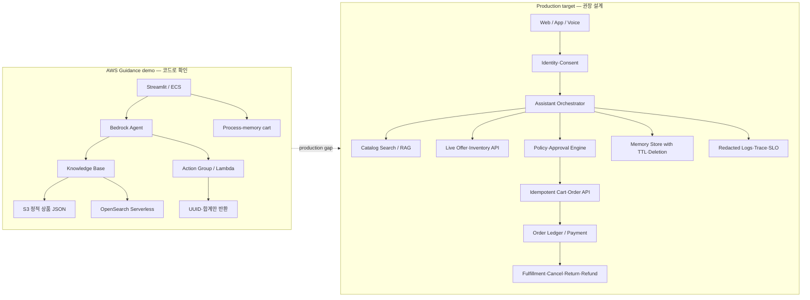
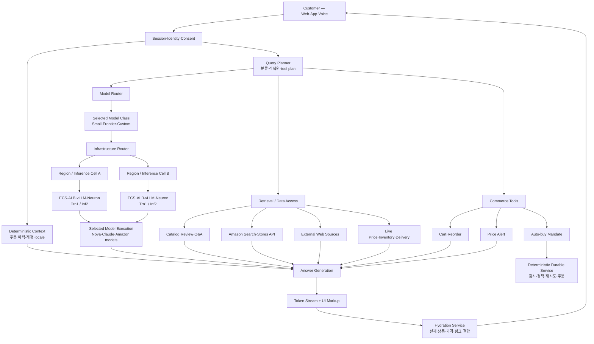
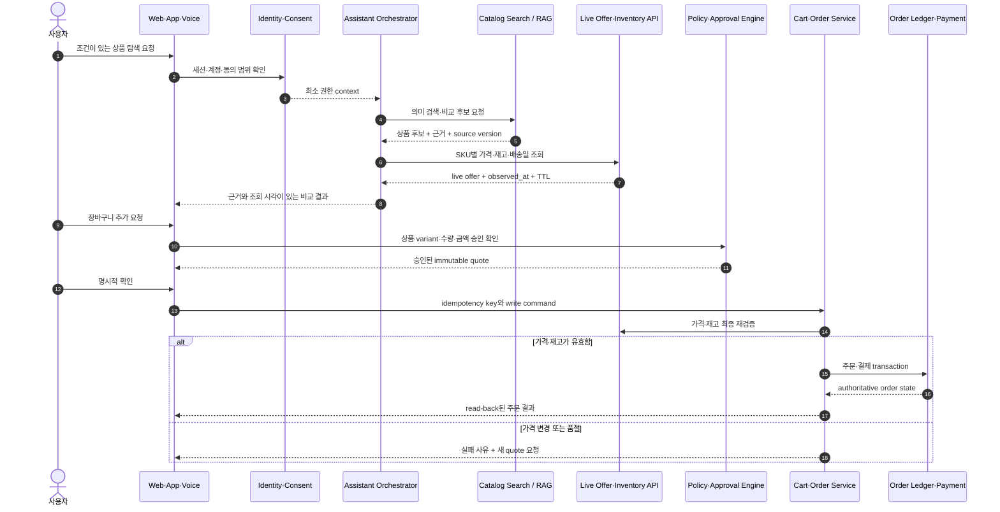

# AWS 기반 커머스 AI Assistant 포스팅 리서치 dossier

> 조사 기준: 2026-10-11 KST
> 목적: 포스팅 작성 전 사례·아키텍처·평가·보안·운영 근거를 고정한다. 이 문서는 포스팅 초안이 아니라 **소재 조사 결과**다.

## 1. 추천 결론

가장 좋은 글은 “Amazon Bedrock으로 쇼핑 챗봇 만들기”가 아니다. 공식 샘플은 이미 RAG와 tool calling을 보여 주지만, 코드에는 실제 주문 원장·재고 예약·결제·메일 발송이 없다.[15][21][22] 반면 Amazon Rufus는 상품 검색뿐 아니라 실시간 가격·재고, 주문 이력, 메모리, 가격 알림, auto-buy를 대규모로 운영하며, 장기 실행은 LLM loop가 아니라 전통적 소프트웨어 서비스에 맡긴다.[1][5]

따라서 권장 논지는 다음과 같다.

> **커머스 AI Assistant에서 어려운 것은 RAG가 아니라 거래 경계다. 상품 설명은 검색해도 되지만 가격·재고·주문·환불은 권위 있는 API에서 다시 확인해야 한다. LLM은 의도를 구조화하고 도구를 선택하되, 거래 확정은 멱등성과 승인 경계를 가진 결정론적 서비스가 맡아야 한다.**

이 논지는 기존 블로그의 RAG·IAM·멀티모델 비용 일반론과 겹치지 않는다. 커머스의 `catalog → offer/SKU → inventory → cart → order → payment/refund` 데이터 수명주기와 source of truth를 중심으로 잡을 수 있다.

## 2. 사례 선정

### 사례 A — Amazon Rufus, 현재 Alexa for Shopping

Rufus는 AWS 기반 커머스 AI Assistant의 가장 깊고 큰 공개 운영 사례다. 2024년에는 쇼핑 전용 자체 LLM, 복수 데이터 소스의 RAG, Trainium·Inferentia 기반 자체 serving을 공개했고, 2025년에는 Amazon Bedrock에서 Nova·Claude Sonnet·자체 모델을 질의 유형별로 선택하는 구조, tool use, account memory를 설명했다.[1][2][5]

Amazon은 2026년 5월 13일 Rufus를 Alexa for Shopping으로 개명했다. 새 경험은 Rufus의 쇼핑 기능과 Alexa+의 개인화 context를 결합한다.[6] 따라서 글에서는 “Rufus의 공개 기술사를 복원하되 현재 제품명은 Alexa for Shopping”이라고 쓰는 편이 정확하다.

**공개된 운영 규모와 vendor claim**

- Prime Day 기준 3개 리전, 80,000개 초과 Trainium·Inferentia 칩, 평균 분당 300만 토큰, 첫 응답 P99 1초 미만.[2]
- Query planner는 300ms SLA, 분당 수백만 query 규모로 설명된다.[3]
- AWS는 비교한 다른 hosting 대안보다 비용이 4.5배 낮았다고 발표했다. 동일 기준이면 비교군의 약 22.2%, 즉 약 77.8% 감소에 해당하지만 비교 대상과 절대 비용은 공개하지 않았다. Watt당 성능 54% 개선, ALB 조정 후 처리량 5배, Trn1에서 Inf2 대비 latency 20% 추가 절감도 AWS 발표 수치다.[2]
- Amazon 발표 기준 2025년 Rufus 이용 고객 수는 11월 시점 2억5천만 이상이었고, 연간 실적 발표에서는 3억 이상이었다. 고유 자연인·계정·지역 중복 제거 기준은 공개되지 않았다.[5][7][8]
- Rufus 사용 쇼핑 여정의 구매 완료 가능성 60% 이상 증가와 약 120억 달러의 `incremental annualized sales`라는 Amazon 발표가 있다.[5][7][8]

마지막 두 지표는 인과적으로 표현하면 안 된다. 무작위 배정, 비교 집단, selection bias 보정, 매출 귀속 모델, 신뢰구간이 공개되지 않았다. “Rufus가 전환을 60% 높였다” 또는 “120억 달러를 벌었다”가 아니라 **Amazon이 그렇게 귀속해 발표했다**고 써야 한다.

### 사례 B — Kate Spade AI Gift Concierge

Kate Spade의 AI Gift Concierge는 발표용 데모가 아니라 KateSpade.com에 공개된 실제 고객 대상 사례다. Tapestry는 2026년 4월 13일 Kate Spade AI Gift Concierge를 고객에게 출시했다. AWS는 이후 이를 “Amazon Bedrock AgentCore로 구축된 최초의 production-ready retail AI assistant”라고 소개했다.[9]

공개 범위는 범용 쇼핑 agent가 아니라 **선물 탐색에 한정된 guided selling**이다. Assistant는 행사·수령인·스타일을 질문하고 상품 카드와 상세 페이지를 제시한다. 공개 모델은 Anthropic Haiku 4.5이며 Amazon Bedrock과 Bedrock AgentCore를 사용한다.[9]

AWS 관계자는 concept-to-live를 약 12주라고 설명했고, 별도 발표는 고객 공개 전 약 2.5개월을 테스트에 사용했다고 한다.[9][10] 두 기간은 중첩되는 것으로 보이나 단계 정의와 산정 기준은 공개되지 않았다. 평가 데이터셋, p95/p99 latency, 부하 규모, guardrail 합격선, A/B 설계도 비공개다. AWS 관계자는 Kate Spade가 conversion rate와 평균주문금액 상승을 보고했다고 전했지만 정량 수치와 실험 설계가 없어 효과 크기와 인과성은 검증할 수 없다.[10]

별도 상품인 Agentic Shopping Assistant on AWS에는 memory, voice, review summarization, cart·checkout 연동 같은 기능이 추가돼 있다.[11][12] 이것은 제품군의 capability이지 Kate Spade가 해당 기능을 모두 활성화했다는 증거가 아니다.

Amazon 내부 Rufus 수치와 Kate Spade 성과를 섞으면 안 된다. 3.5배 전환 수치는 AWS 발표문에 출처와 측정 방법 없이 제시된 일반적 마케팅 주장이므로 Kate Spade나 Rufus의 관측 결과로 귀속하면 안 된다.[9] 약 120억 달러 증분 매출은 Amazon이 Rufus에 귀속한 별도 발표 수치다.[8]

### 사례 C — AWS Generative AI Shopping Assistant Guidance

AWS 공식 Guidance와 GitHub 샘플은 공개된 배포형 reference implementation이지만 production 고객 사례는 아니다. 기준 커밋은 `e2c4d0017b5a37527e9590b65ee5b8d4dc2e9015`다.[14] 이 dossier에서는 소스 정적 검토까지만 수행했으며 실제 AWS 계정에서의 배포 성공과 버전 재현성은 검증하지 않았다.

샘플은 Streamlit/ECS, Cognito, API Gateway/Lambda, Bedrock Agent, Bedrock Knowledge Bases, S3, OpenSearch Serverless를 CDK로 배포한다.[15][16][17] 2,449개 상품을 상품별 text/metadata로 변환하고 Titan Text Embeddings v1 1536차원, FAISS/HNSW OpenSearch index, Claude 3 Sonnet Agent로 연결한다.[17][19]

그러나 거래 기능은 이름과 실제 구현이 다르다.

- DynamoDB·Aurora·RDS 같은 트랜잭션 DB가 없다.
- 상품 원장은 S3의 정적 JSON이다.[20][22]
- `createOrder`는 UUID와 합계를 반환할 뿐 주문을 저장하지 않는다.[21]
- `sendEmail`은 실제 메일을 보내지 않고 성공 문자열만 반환한다.[21]
- 재고는 정적 값을 읽을 뿐 예약·차감하지 않는다.[22]
- 장바구니와 세션은 Streamlit process memory에 의존한다.[23]
- 모델이 넘긴 상품명·가격·수량으로 합계를 계산하므로 서버 측 authoritative catalog 재검증이 없다.[18][21]

이 코드는 “AWS 서비스 조합법”을 보여 주는 데는 좋지만, 실제 커머스 구축 사례로 소개할 때는 **실행 가능한 demo와 production transaction system을 분리**해야 한다.

### Guidance demo와 production target 비교

아래 왼쪽은 기준 커밋에서 확인한 구현이고, 오른쪽은 그 구조를 실제 거래 시스템으로 전환할 때 필요한 목표 구조다. 오른쪽은 AWS가 공개한 Kate Spade 내부 구현도가 아니라 이 dossier의 권장 설계다.

### 세 자산의 관계

| 자산 | 확인된 범위 | 동일시하면 안 되는 것 |
|---|---|---|
| Rufus/Alexa for Shopping | Amazon 내부 대규모 production 서비스 | 외부 retailer에게 Rufus 코드·모델이 그대로 제공됐다고 볼 수 없음 |
| Agentic Shopping Assistant on AWS와 Kate Spade | Retailer별 고객 구축 engagement와 공개 적용 사례 | Rufus와 동일한 planner·ranking·production code라는 근거 없음 |
| GitHub Guidance | 공개 배포형 demo/reference implementation | 2026년 ASA의 코드베이스나 Kate Spade 구현이라는 근거 없음 |

AWS가 외부 retailer에게 제공한다고 밝힌 것은 Rufus/Alexa에서 얻은 학습과 architecture pattern이다.[9] 동일 모델, 동일 query planner 또는 동일 production source code를 이전했다고 확대하면 안 된다. ASA가 retailer의 AWS 계정에서 실행되고 AWS가 고객 데이터를 공유하지 않는다는 설명도 AWS의 privacy claim으로 한정해야 한다.[9]

## 3. 공개 자료로 복원한 Rufus 아키텍처

아래 그림은 Amazon이 단일 설계도로 공개한 공식 내부 구성도가 아니다. 공개된 제품·과학·AWS 자료를 바탕으로 확인 가능한 경계만 연결한 **logical architecture reconstruction**이다. 점선이나 내부 알고리즘을 임의로 채우지 않고, 비공개 항목은 본문에서 분리한다.[1][2][3][4][5]

### 3.1 세 종류의 라우팅

Rufus를 이해할 때 모델 하나로 설명하면 안 된다.

1. **Model router** — 단순 사양 질문은 작고 빠른 모델, 여행·선물·스타일처럼 복잡한 요청은 깊은 reasoning·web search가 가능한 모델로 보낸다.[5]
2. **Query planner** — 질문을 분류하고 어떤 검색원·API·tool을 어떤 순서로 호출할지 계획한다.[3]
3. **Infrastructure router** — 요청을 리전·host·multi-node cell로 분산하고 장애·부하를 회피한다.[2][4]

라우터의 feature, threshold, 모델별 traffic 비중, fallback, 품질/비용 가중치는 비공개다. Rufus가 Bedrock의 일반 Intelligent Prompt Routing 상품을 사용한다고 볼 근거도 없다.

### 3.2 RAG는 벡터 DB 하나가 아니다

공개 자료상 Rufus는 상품 catalog, 리뷰, 커뮤니티 Q&A, Stores API, Amazon 검색결과, 외부 웹 자료, 모델 자체 지식 등 여러 정보원을 사용한다.[1][2][5] 이를 단일 벡터 DB보다 다중 검색원·API를 조합하는 **federated-retrieval 형태**로 해석할 수 있다. 이는 공개 정보에 기반한 분석 용어이지 Amazon이 공개한 내부 컴포넌트명은 아니다.

Production index 기술, chunking, embedding, top-k, reranker, freshness SLA, citation precision은 공개되지 않았다. Amazon Science의 REAPER 논문은 tool·순서·인자를 한 번에 생성하는 작은 planner를 제안하고 96% tool sequence 정확도, 92% argument 정확도, 207ms plan latency를 보고하지만, 논문이 Rufus production 구현이라고 명시하지는 않는다.[13]

### 3.3 Deterministic context와 tool use의 혼합

주문 이력처럼 이미 확실한 context는 첫 inference request에 직접 넣고, 추가 정보가 필요할 때 tool을 호출한다.[5] 모든 질문을 agent loop로 처리하지 않아 inference 횟수와 downstream 오류 전파를 줄이는 구조다.

가격·재고·최신 catalog는 live database에서 조회한다. 가격 이력, 알림, 재주문, cart, auto-buy가 공개된 action 사례다.[5][6]

### 3.4 Durable execution은 전통적 서비스가 맡는다

Auto-buy에서 agent는 사용자의 의도와 조건으로 persistent record를 만든다. 이후 가격 감시와 실제 주문 실행은 전통적 소프트웨어 서비스가 수행한다.[5]

이 경계가 포스팅의 핵심 사례다. LLM을 장기 실행 엔진으로 두는 대신 **intent compiler**로 쓰고, durable workflow·idempotency·재시도·감사는 결정론적 시스템에 맡긴다.

### 3.5 Streaming과 hydration

Rufus는 token 단위 streaming을 하고, 모델은 텍스트와 UI element용 markup instruction을 생성한다. 내부 서비스가 상품·링크·실제 데이터를 스트림에 채우는 과정을 Amazon은 `hydration`이라고 부른다.[1][2]

이는 LLM이 가격과 상품 카드를 자유 텍스트로 확정하게 하는 방식과 다르다. 모델은 표시 의도를 선언하고 authoritative service가 실제 값을 결합한다. 공개되지 않은 부분은 markup schema, partial failure, ordering, backpressure, consistency, timeout 정책이다.

### 3.6 Serving substrate

2024년 공개 stack은 Inf2·Trn1, AWS Neuron SDK, ECS, ALB, NVIDIA Triton Python backend, vLLM, INT8 weight-only quantization, continuous batching이다.[2]

더 큰 모델은 단일 instance에 들어가지 않아 vLLM leader/follower, prefill context parallelism, decode data parallelism, Gloo/TCP input broadcast, NxDI/EFA accelerator collective를 조합했다. ECS의 multi-node inference unit을 cell 단위 배포·확장 단위로 사용했다.[4]

Bedrock 도입이 자체 serving을 전면 대체했다는 증거는 없다. 공개 자료는 managed frontier model과 custom model의 혼합을 가리킨다.[4][5]

## 4. 데이터별 source of truth

| 데이터·행동 | 권장 처리 | 이유 |
|---|---|---|
| 상품 설명·사용법·FAQ·비교 기준 | Search/RAG | 비정형 지식 검색에 적합 |
| 가격·재고·배송일·쿠폰 | Live commerce API | 시점·seller·offer·locale마다 변함 |
| 주문·배송 상태 | 인증된 고객별 API | 사용자 소유권 검증 필요 |
| 장바구니 추가 | 구조화된 write tool | 수량·variant·멱등성 필요 |
| 주문 확정·결제·환불 | 명시적 승인 뒤 결정론적 API | 금전·규제·복구 경계 필요 |
| 사용자 선호 | 별도 memory store | 출처·동의·TTL·삭제 필요 |

예시 질의는 다음이 좋다.

> “20만 원 이하 러닝화 중 내 사이즈 재고가 있고 금요일까지 배송되는 상품만 비교해 줘.”

권장 trace는 `identity/consent → intent extraction → semantic retrieval → live offer·inventory 조회 → 배송·할인 policy → 근거와 조회시각이 있는 비교 → cart write 승인 → idempotent command → read-back`이다.

### 4.1 상품 탐색부터 주문까지의 sequence

## 5. 실패 모드와 production gap

### 5.1 가격·재고 freshness

검색 index에는 재고가 있어도 주문 시스템에서는 품절일 수 있다. 답변에는 `offer_id/SKU`, seller, fulfillment channel, locale, quantity, `observed_at`, source version, TTL을 함께 보존해야 한다. Cart 추가와 결제 직전에 가격·재고·배송일을 다시 확인하고 불일치하면 추정하지 말아야 한다.

### 5.2 간접 prompt injection

리뷰·판매자 설명·웹 검색 결과는 모두 비신뢰 데이터다. 외부 문서의 명령이 tool 호출로 이어질 수 있으므로 `trusted policy / authenticated commerce fact / user data / untrusted text`를 분리해야 한다.[25][26]

입력 필터만으로 충분하지 않다. Tool 최소권한, read/write 분리, 금액·수량 한도, egress 제한, 정책 엔진, state-changing action의 confirmation이 필요하다.[24]

### 5.3 Memory와 공동 계정

취미·가족·반려동물·과거 구매를 활용하는 account memory는 개인화를 높이지만 공동 계정·공유 device에서 다른 사람의 민감한 관심사를 노출할 수 있다.[5][6]

Memory는 opt-in, 목적 제한, provenance, TTL, 수정·삭제 UI가 필요하다. 삭제는 원문 event, 요약, embedding, cache, analytics log에 전파되는 tombstone workflow로 봐야 한다.

Alexa for Shopping은 Amazon 쇼핑 이력과 Alexa+ 대화·선호를 결합한다.[6] 따라서 공동 계정 위험뿐 아니라 서비스 surface 간 consent, 목적 제한, 민감정보 추론, 계정 연결 해제 시 데이터 처리까지 별도 경계로 다뤄야 한다.

### 5.4 구매 승인

“장바구니에 담아 줘”를 결제 승인으로 확대하면 안 된다. 결제 전에는 상품·variant·seller·수량·총액·배송지·결제수단·만료시각을 서버가 만든 immutable quote로 보여 주고 사용자가 확인해야 한다.

Auto-buy 같은 장기 위임에는 대상, 최대 총액, 목표 가격, 수량, seller/fulfillment, 유효기간, 취소 규칙을 mandate로 저장해야 한다. 실행 시 live quote와 mandate를 정책 엔진이 비교하며 모델이 승인 여부를 결정해서는 안 된다.

### 5.5 AWS 샘플의 보안·운영 공백

공식 샘플은 Route 53 설정을 생략하면 인증 없이 internet-facing ALB/HTTP 앱으로 동작할 수 있고 ECS task에 public IP를 부여한다.[16][28] Task security group은 ALB에서 오는 8501 traffic만 허용하므로 public IP가 곧 직접 인터넷 노출이라는 뜻은 아니다. OpenSearch Serverless network policy는 public access를 허용한다.[29]

Bedrock invocation, Knowledge Base, API Gateway, ECS, VPC Flow, CloudFront log는 있지만 alarm, SLO, distributed trace, PII redaction 정책은 없다.[16][17][30] 더 직접적인 blocker는 `createOrder` Lambda가 action event 전체를 기록하고 Bedrock model input/output logging도 활성화한다는 점이다.[21][30] 이름·이메일·주소와 prompt/response가 기본 로그 경로로 들어갈 수 있으므로 production에서는 최소 수집, redaction, 접근 통제, 환경별 보존 기한을 먼저 설계해야 한다. Agent trace의 rationale·model input/output·action invocation을 UI에 노출하는 것도 production에서는 분리해야 한다.[15][23]

### 5.6 거래 이후 lifecycle과 추천의 상업적 이해관계

취소·부분 배송·대체 상품·반품·환불·chargeback은 공개 사례와 샘플에서 구현이 확인되지 않았다. 아래 권장 설계는 확인된 AWS 사례가 아니라 production gap이다. 주문 후 workflow도 주문 ID, 상태 전이, 멱등성, 보상 transaction, 고객 알림, 사람 escalation을 포함해야 한다.

추천 품질에는 relevance만 아니라 상업적 이해관계도 들어간다. Sponsored placement, seller·brand 편중, 자체상품 우대, 광고 표시, 추천 이유를 평가해야 한다. Off-Amazon 구매에서는 merchant 선택과 판매자 책임도 별도 정책 경계다. NDCG와 seller concentration만으로 이 문제를 모두 설명할 수 없다.

## 6. 평가 설계

### Offline gate

- **Freshness set:** 시점별 catalog snapshot과 live answer를 분리해 가격·재고·배송·옵션 정확도와 abstention을 평가한다.
- **Retrieval/ranking:** Recall·NDCG뿐 아니라 diversity, coverage, 품절 노출률, source match, seller concentration을 본다.
- **Transaction state:** 자연어 답변 점수보다 최종 DB state와 policy 준수, idempotency, 중복 주문 여부를 판정한다.
- **Security:** 리뷰·판매자 설명·웹·OCR·memory에 간접 injection을 넣고 unauthorized state change와 정상 utility를 함께 측정한다.[26]
- **Regression:** model, prompt, router, catalog API, guardrail version마다 golden·adversarial set을 재실행한다.

### Online experiment

Amazon의 60% 수치를 그대로 목표로 잡으면 안 된다. Eligible user/session을 무작위 배정하고 assignment 기준 ITT를 1차 지표로 삼아야 한다. Assistant를 자발적으로 사용한 사람만 비교하면 구매 의도가 높은 집단의 자기선택을 제거할 수 없다.

1차 지표는 증분 완료 주문이나 contribution margin으로 두되 반품·취소·불만·잘못된 가격·품절 노출·latency·비용·seller 편중을 guardrail로 둔다. 재고와 seller 노출이 실험군 사이에서 경쟁하면 graph/cluster 기반처럼 간섭을 고려한 설계가 필요하다.[27] 시간대별 switchback도 가능한 대안이지만 이 dossier의 인용 자료가 직접 검증한 방식은 아니다.

## 7. 비용·지연에서 공개된 것과 모르는 것

Rufus 자료에는 상대 비용 개선과 특정 component latency가 공개돼 있다. 하지만 질의당 달러 비용, 사용자당 비용, full-answer P50/P95/P99, retrieval/tool별 지연 분해, 모델별 traffic 비중은 없다.

따라서 글에서 제시할 비용 모델은 다음처럼 조직별 측정 공식이어야 한다.

`cost per successful assisted order = (model + embedding + search + tool/API + compute + observability + failed/retried transaction cost) / policy-compliant completed assisted orders`

Token 단가만 비교하면 tool 실패, stale 조회, 재시도, cart abandonment, 환불·취소 비용이 빠진다.

## 8. 추천 제목 후보

1. **RAG만으로는 부족했다 — Amazon Bedrock 커머스 AI Assistant에서 가격·재고 환각과 중복 주문을 막는 설계**
2. **Amazon Rufus는 왜 LLM에게 구매를 끝까지 맡기지 않았나**
3. **Amazon Bedrock로 커머스 AI 쇼핑 어시스턴트 구축하기 — 상품 검색부터 재고·주문·환불까지**
4. **AWS 공식 쇼핑 Assistant 샘플을 코드까지 뜯어보니 주문 시스템이 없었다**
5. **Kate Spade AI Gift Concierge 구축 사례 — 12주 출시 뒤에도 공개되지 않은 것들**
6. **Rufus에서 Alexa for Shopping까지 — 대규모 커머스 AI Assistant의 세 가지 라우팅**
7. **커머스 AI의 진짜 Source of Truth — 상품 설명은 RAG, 가격과 주문은 Live API**

### 최우선 추천

**RAG만으로는 부족했다 — Amazon Bedrock 커머스 AI Assistant에서 가격·재고 환각과 중복 주문을 막는 설계**

이 제목이 가장 좋은 이유는 Rufus의 production 구조, Kate Spade의 실제 고객 사례, AWS Guidance의 코드 한계를 하나의 논지로 묶을 수 있기 때문이다. AWS 서비스 나열이나 일반 RAG 튜토리얼과도 구분된다.

## 9. 권장 포스팅 목차

1. 왜 커머스 AI Assistant는 일반 챗봇과 다른가
2. Rufus/Alexa for Shopping의 실제 규모와 vendor claim 경계
3. Model router, query planner, infrastructure router
4. 상품 지식과 거래 사실의 source of truth 분리
5. Kate Spade Gift Concierge가 실제로 공개한 것과 공개하지 않은 것
6. AWS Guidance 코드를 뜯어보니 주문·재고 원장이 없었다
7. 가격·재고·배송·cart·결제의 end-to-end trace
8. Prompt injection, memory, 승인, idempotency 실패 모드
9. Offline eval과 randomized online experiment
10. Production 전환 체크리스트와 결론

## 10. 글에서 피해야 할 과장

- Rufus가 독립적으로 120억 달러를 벌었다고 쓰지 않는다.
- Rufus 사용자의 구매 가능성 60% 증가를 무작위 실험의 인과 효과로 쓰지 않는다.
- REAPER 연구 구현을 Rufus production query planner로 확정하지 않는다.
- 출처와 측정 방법이 공개되지 않은 3.5배 전환 주장을 Kate Spade나 Rufus에 귀속하지 않는다.
- Kate Spade가 ASA의 memory·voice·cart·Shopify 기능을 모두 사용한다고 쓰지 않는다.
- AWS Guidance의 `createOrder`를 실제 주문 생성·결제 구현으로 소개하지 않는다.
- API key를 고객 인증으로, static S3 stock을 실시간 재고로 표현하지 않는다.
- 4.5배 비용, 50% QP cost, 54% performance/watt, 5배 throughput을 하나의 누적 TCO 개선치로 합산하지 않는다.
- 80,000 chips를 instance 수나 동시 사용자 수로 바꾸어 쓰지 않는다.

## Sources

[1] https://www.amazon.science/blog/the-technology-behind-amazons-genai-powered-shopping-assistant-rufus
[2] https://aws.amazon.com/blogs/machine-learning/scaling-rufus-the-amazon-generative-ai-powered-conversational-shopping-assistant-with-over-80000-aws-inferentia-and-aws-trainium-chips-for-prime-day
[3] https://aws.amazon.com/blogs/machine-learning/how-rufus-doubled-their-inference-speed-and-handled-prime-day-traffic-with-aws-ai-chips-and-parallel-decoding
[4] https://aws.amazon.com/blogs/machine-learning/how-amazon-scaled-rufus-by-building-multi-node-inference-using-aws-trainium-chips-and-vllm
[5] https://aws.amazon.com/blogs/machine-learning/how-rufus-scales-conversational-shopping-experiences-to-millions-of-amazon-customers-with-amazon-bedrock
[6] https://www.aboutamazon.com/news/retail/alexa-for-shopping-ai-assistant
[7] https://www.aboutamazon.com/news/retail/amazon-agentic-ai-gen-ai-shopping
[8] https://ir.aboutamazon.com/files/doc_earnings/2025/q4/earnings-result/AMZN-Q4-2025-Earnings-Release.pdf
[9] https://www.aboutamazon.com/news/aws/aws-agentic-shopping-assistant-retailers
[10] https://podcasts.apple.com/us/podcast/a-rough-idea-ai-became-kate-spades-concierge-heres-how/id1881350943?i=1000772717030
[11] https://aws.amazon.com/marketplace/pp/prodview-5d6waertx73zq
[12] https://aws.amazon.com/blogs/industries/introducing-seven-new-features-of-the-agentic-shopping-assistant-on-aws/
[13] https://www.amazon.science/publications/reaper-reasoning-based-retrieval-planning-for-complex-rag-systems
[14] https://github.com/aws-solutions-library-samples/guidance-for-generative-ai-shopping-assistant-using-agents-for-amazon-bedrock/commit/e2c4d0017b5a37527e9590b65ee5b8d4dc2e9015
[15] https://github.com/aws-solutions-library-samples/guidance-for-generative-ai-shopping-assistant-using-agents-for-amazon-bedrock/blob/e2c4d0017b5a37527e9590b65ee5b8d4dc2e9015/README.md
[16] https://github.com/aws-solutions-library-samples/guidance-for-generative-ai-shopping-assistant-using-agents-for-amazon-bedrock/blob/e2c4d0017b5a37527e9590b65ee5b8d4dc2e9015/deployment/app.py
[17] https://github.com/aws-solutions-library-samples/guidance-for-generative-ai-shopping-assistant-using-agents-for-amazon-bedrock/blob/e2c4d0017b5a37527e9590b65ee5b8d4dc2e9015/deployment/lib/bedrock_product_kb_stack.py
[18] https://github.com/aws-solutions-library-samples/guidance-for-generative-ai-shopping-assistant-using-agents-for-amazon-bedrock/blob/e2c4d0017b5a37527e9590b65ee5b8d4dc2e9015/deployment/bedrock_agent/shopping_agent/action_groups/create_order_actions/api_schema/create_order_actions.openapi.json
[19] https://github.com/aws-solutions-library-samples/guidance-for-generative-ai-shopping-assistant-using-agents-for-amazon-bedrock/blob/e2c4d0017b5a37527e9590b65ee5b8d4dc2e9015/deployment/lib/upload_catalog_and_kb_sync_stack.py
[20] https://github.com/aws-solutions-library-samples/guidance-for-generative-ai-shopping-assistant-using-agents-for-amazon-bedrock/blob/e2c4d0017b5a37527e9590b65ee5b8d4dc2e9015/deployment/lib/product_service_stack.py
[21] https://github.com/aws-solutions-library-samples/guidance-for-generative-ai-shopping-assistant-using-agents-for-amazon-bedrock/blob/e2c4d0017b5a37527e9590b65ee5b8d4dc2e9015/deployment/bedrock_agent/shopping_agent/action_groups/create_order_actions/lambda/index.py
[22] https://github.com/aws-solutions-library-samples/guidance-for-generative-ai-shopping-assistant-using-agents-for-amazon-bedrock/blob/e2c4d0017b5a37527e9590b65ee5b8d4dc2e9015/source/product_service/index.py
[23] https://github.com/aws-solutions-library-samples/guidance-for-generative-ai-shopping-assistant-using-agents-for-amazon-bedrock/blob/e2c4d0017b5a37527e9590b65ee5b8d4dc2e9015/source/retail_ai_assistant_app/pages/1_Shopping_Agent.py
[24] https://docs.aws.amazon.com/bedrock/latest/userguide/agents-userconfirmation.html
[25] https://dl.acm.org/doi/10.1145/3605764.3623985
[26] https://arxiv.org/abs/2406.13352
[27] https://proceedings.neurips.cc/paper/2021/hash/32e19424b63cc63077a4031b87fb1010-Abstract.html
[28] https://github.com/aws-solutions-library-samples/guidance-for-generative-ai-shopping-assistant-using-agents-for-amazon-bedrock/blob/e2c4d0017b5a37527e9590b65ee5b8d4dc2e9015/deployment/lib/ecs_app_stack.py
[29] https://github.com/aws-solutions-library-samples/guidance-for-generative-ai-shopping-assistant-using-agents-for-amazon-bedrock/blob/e2c4d0017b5a37527e9590b65ee5b8d4dc2e9015/deployment/lib/opensearch_serverless_stack.py
[30] https://github.com/aws-solutions-library-samples/guidance-for-generative-ai-shopping-assistant-using-agents-for-amazon-bedrock/blob/e2c4d0017b5a37527e9590b65ee5b8d4dc2e9015/deployment/lib/bedrock_logging_setup.py
